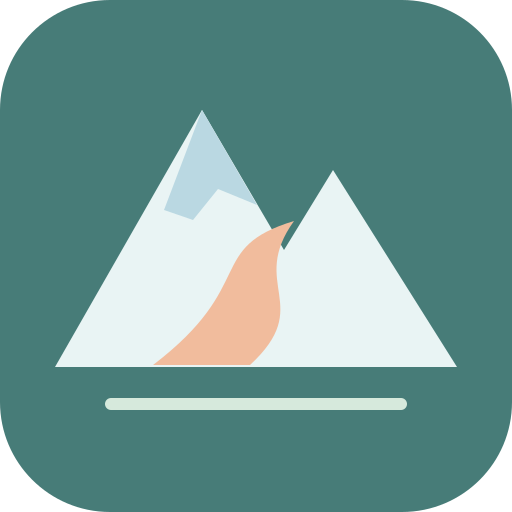
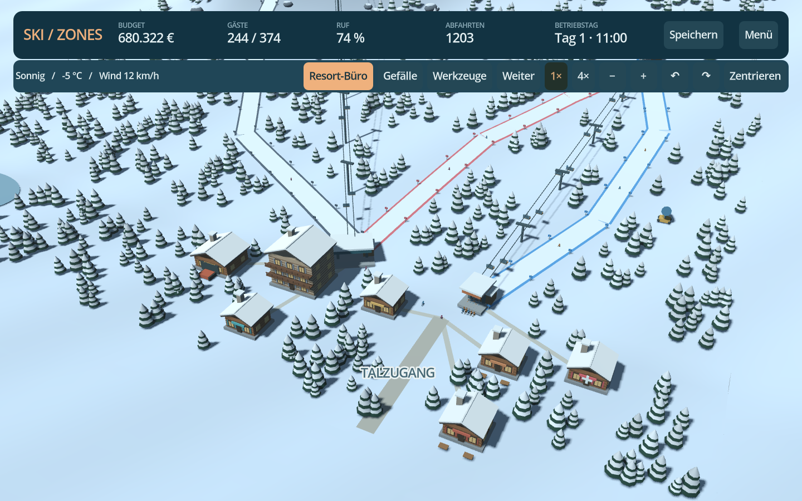
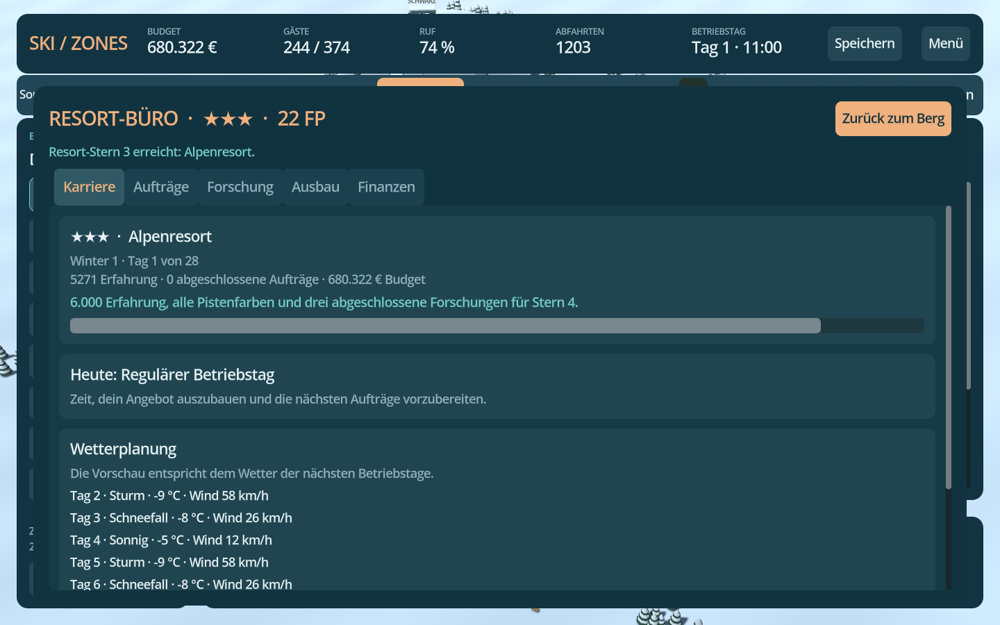
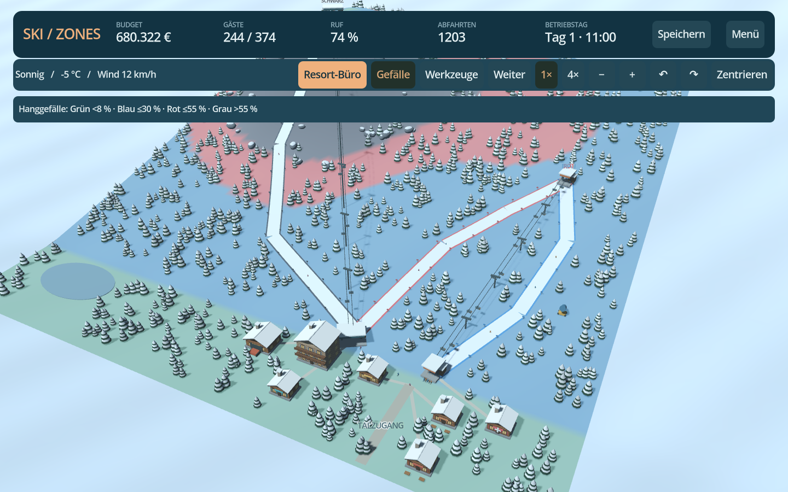
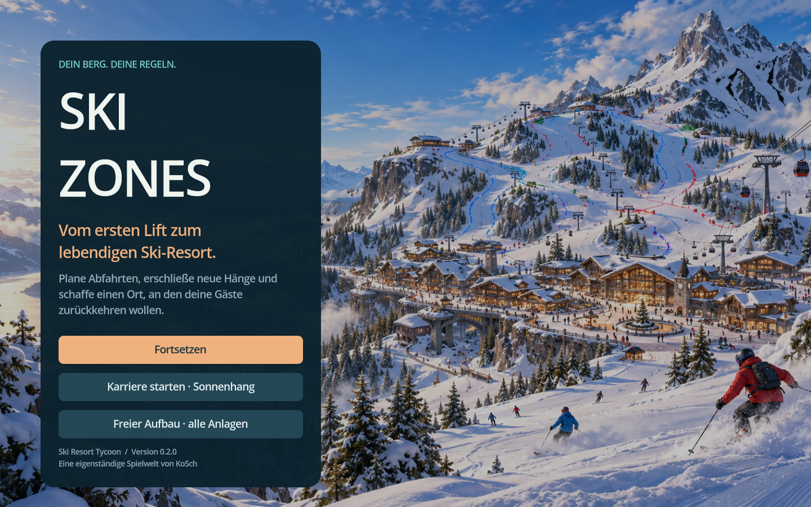

<div align="center">



# SkiZones

**Dein Berg. Dein Resort. Dein nächster Winter.**

Ein eigenständiger 3D Ski Resort Tycoon für Android. Plane Abfahrten, erschließe neue Hänge und entwickle dein Skigebiet über mehrere Wintersaisons.

### [⬇ Android-APK direkt herunterladen · v0.2.0](https://github.com/chekento/SkiZones/releases/download/v0.2.0/SkiZones-0.2.0-android-arm64.apk)

[Release & Installation](https://github.com/chekento/SkiZones/releases/tag/v0.2.0) · [SHA-256-Prüfsumme](https://github.com/chekento/SkiZones/releases/download/v0.2.0/SkiZones-0.2.0-android-arm64.apk.sha256) · [Alle Downloads](https://github.com/chekento/SkiZones/releases)

[](https://github.com/chekento/SkiZones/actions/workflows/validate-and-build.yml)

</div>



*Direkt aus dem Spiel gerendert: ein ausgebautes Testresort mit drei Pisten und zwei Liften. Die Karriere beginnt mit einem kleineren Sonnenhang.*

## Jetzt anspielen

1. Oben die **APK herunterladen** und auf deinem Android-Gerät öffnen.
2. Bei Bedarf die Installation aus dieser Quelle erlauben.
3. **Karriere starten · Sonnenhang** wählen: Ein blauer Rundweg mit Lift, Hütte und Skiverleih ist bereits in Betrieb.
4. Im **Resort-Büro** einen Auftrag annehmen und die erste Forschung wählen. Während der Planung pausiert der Betrieb.

| Plattform | Voraussetzung |
|---|---|
| Android | Android 7.0 oder neuer · ARM64 · Querformat |
| Verbindung | Offline spielbar · kein Account erforderlich |
| Version | 0.2.0 Preview · mit einem Testschlüssel signiert |
| Computer | Godot 4.5.1 Standard · `project.godot` importieren · F5 |

Die APK, ihre Prüfsumme und Build-Metadaten liegen dauerhaft im GitHub-Release. Hinweise zu Updates und älteren Spielständen stehen in den [Release-Notizen](docs/releases/0.2.0.md).

## Neu in 0.2.0: ein Resort, das mitwächst

| Neue Entwicklung | Was du damit spielst |
|---|---|
| **Überarbeitete 3D-Grafik** | Holzchalets mit Fenstern, Balkonen und Schneedächern, eigene Liftstationen, bewegte Sessel und Gondeln, modellierte Skifahrer, verschneite Tannen, Felsen und zusammenhängendes Gelände |
| **Wetter und Licht** | Kühleres Schneelicht, Waldschatten, Dunst, Schneefall und eine Perspektivkamera mit dreh- und zoombarem Blick |
| **Fünf Resort-Sterne** | Erfahrung mit einem tatsächlich erschlossenen Netz, Pistenvielfalt, Komfort und abgeschlossenen Aufträgen verbinden |
| **Neun Forschungen** | Geld und Forschungspunkte in Projekte investieren, die nach einem bis drei Betriebstagen neue Anlagen oder Verbesserungen freischalten |
| **Drei Ausbaustufen** | Bestehende Lifte schneller und leistungsfähiger machen, Pistenverschleiß verringern und Gebäude verbessern; der Unterhalt wächst mit |
| **Wechselnde Aufträge** | Jeden Tag drei Angebote, messbare Ziele, mehrtägige Fristen und einmalige Geld- und Forschungsprämien |
| **Wiederkehrende Winter** | 28 Betriebstage pro Winter, Saisonprämie und fortbestehendes Resort; Schulgruppen sowie Familien- und Sportwochenenden verändern die Nachfrage |
| **Resort-Büro** | Karriere, Aufträge, Forschung, Ausbau, Wettervorschau nach Forschung und 28 Tage Finanzverlauf an einem Ort |

**Karriere** schaltet fortgeschrittene Technik durch Forschung frei. **Freier Aufbau** beginnt auf leerem Gelände und stellt alle Anlagentypen und Ausbaustufen direkt bereit; Aufträge und Forschungseffekte bleiben nutzbar. Vorhandene Spielstände aus 0.1.x behalten den Zugang zu ihren bisherigen Baumöglichkeiten.



## Baue dein Skigebiet

| System | Bereits spielbar |
|---|---|
| Pisten | Frei gesetzte Wegpunkte · blau, rot und schwarz · Prüfung des gesamten Streckenprofils · Ausbau |
| Lifte | Schlepplift, 4er-Sessel und Gondel · echte gemeinsame Förderkapazität · Windgrenzen · Ausbau |
| Gebäude | Hütte, Restaurant, Skiverleih, Skischule, Beschneiung, Garage, Hotel und Bergwacht |
| Gäste | Können, Rundwege, Warteschlangen, Skirunden, Ausgaben und Zufriedenheit |
| Wirtschaft | Tageskarten, Bau- und Betriebskosten, Forschungskosten, Kredit, Prämien und Ergebnis nach Investitionen |
| Berg und Wetter | Schnee, Tauwetter, Windschließungen, Verschleiß, Präparierung und Forschungsprognose |
| Spielstände | Lokal speichern und fortsetzen · Prüfsumme · vorherige Sicherung · Migration aus 0.1.x |

Gebäude wirken derzeit über Kennzahlen. Die vorgegebene Landschaft ist noch nicht verformbar. Einzelne Hotelbuchungen, Personal, weitere Karten und die langfristige Feinabstimmung der Wirtschaft folgen im [Ausbauplan](docs/ROADMAP.md).

<details>
<summary>Gefälleansicht und Hauptmenü ansehen</summary>



Die Farben zeigen die stärkste lokale Hangneigung. Die Schwierigkeit einer Abfahrt wird entlang ihrer tatsächlichen Route geprüft; Serpentinen können eine mildere Abfahrt ermöglichen.



Das Panorama ist das Titelmotiv im Hauptmenü. Die anderen Bilder zeigen die tatsächliche 3D-Spielansicht.

</details>

## Deine erste Erweiterung

Eine Pistenfarbe wählen, oben am Hang beginnen und weitere Wegpunkte bergab setzen. **Bauen** bestätigt die Route. Beim Lift zuerst die Talstation und dann die Bergstation setzen. Gäste benötigen einen vollständigen Rundweg vom Talzugang und zurück.

Stationen und Pistenenden verbinden sich innerhalb von **42 m**. Im Tal können Gäste zwischen Anlagen bis **220 m** zu Fuß gehen. **Blau ≤30 %, Rot ≤55 %, Schwarz ≤110 %** sind die Gefällegrenzen des Spiels.

| Aktion | Touch | Maus / Tastatur |
|---|---|---|
| Punkt setzen oder Anlage auswählen | Antippen | Linksklick |
| Karte bewegen | Ziehen | Ziehen mit linker/mittlerer Maustaste |
| Zoomen | Zwei Finger oder −/+ | Mausrad oder −/+ |
| Drehen | ↶ / ↷ | Q / E |
| Größere Karte | Mehr Karte / Werkzeuge | Tab |
| Resort-Büro | Resort-Büro | M |
| Pause | Pause / Weiter | Leertaste |
| Speichern | Speichern | Strg+S |

## Entwicklung und Qualität

Das Projekt verwendet **Godot 4.5.1**, GDScript und den Compatibility-Renderer. Code, Oberfläche und prozedurale Modelle wurden für SkiZones erstellt. Das Hauptmenü nutzt das freigegebene Alpenpanorama. API-Schlüssel und kostenpflichtige Assets sind nicht erforderlich.

**143 automatisierte Prüfungen** decken Simulation, Spielstände, Karriere, Verbindungen, Liftkapazität, Oberfläche und Touch-Bedienung ab. Ein Karrieretest spielt **56 vollständige Betriebstage** mit echten Gästen, Wetter, Forschung, Aufträgen und Speicherfortsetzungen durch. GitHub Actions prüft Projekt, APK-Signatur und Archiv vor der Veröffentlichung. Eine Prüfung auf einem physischen Android-Gerät steht noch aus.

```bash
godot --headless --editor --import --quit
godot --headless --script tests/run.gd
godot --headless --script tests/progression.gd
godot --headless --script tests/scene.gd
godot --headless -- --smoke-test
```

[Android-Build](docs/ANDROID.md) · [Architektur und Spielsysteme](docs/DESIGN.md) · [Prüfstand](docs/VALIDATION.md) · [Roadmap](docs/ROADMAP.md)

## Rechte

Eine eigenständige Spielwelt von **KoSch**. Fremde Spielgrafiken, Marken oder Sounds werden nicht mitgeliefert. [Godot und seine Bestandteile](https://godotengine.org/license/) sowie die Android-Werkzeuge bleiben unter den Lizenzen ihrer Anbieter. Für dieses Repository ist bislang keine zusätzliche Open-Source-Lizenz erteilt.
