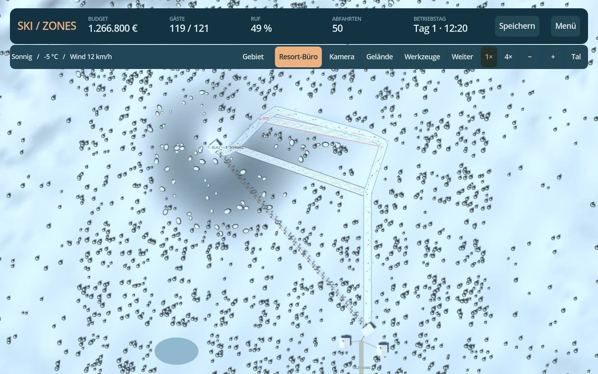

<div align="center">


# SkiZones

**Dein Berg. Dein Resort. Dein nächster Winter.**

Ein eigenständiger 3D Ski Resort Tycoon für Android. Plane Abfahrten, erschließe neue Hänge und entwickle dein Skigebiet über mehrere Wintersaisons.

### [⬇ Android-APK direkt herunterladen · v0.4.0](https://github.com/chekento/SkiZones/releases/download/v0.4.0/SkiZones-0.4.0-android-arm64.apk)

[Release & Installation](https://github.com/chekento/SkiZones/releases/tag/v0.4.0) · [SHA-256-Prüfsumme](https://github.com/chekento/SkiZones/releases/download/v0.4.0/SkiZones-0.4.0-android-arm64.apk.sha256) · [Alle Downloads](https://github.com/chekento/SkiZones/releases)

[](https://github.com/chekento/SkiZones/actions/workflows/validate-and-build.yml)

</div>



*Direkt aus dem Spiel: ein Testresort mit einer blauen Route und angedockten roten und schwarzen Abkürzungen. Die Karriere beginnt mit einem kleineren blauen Rundweg.*

## Jetzt anspielen

1. Oben die **APK herunterladen** und auf deinem Android-Gerät öffnen.
2. Bei Bedarf die Installation aus dieser Quelle erlauben.
3. **Gebiete entdecken** und **Sonnenhang** wählen: Ein blauer Rundweg mit Lift, Hütte und Skiverleih ist bereits in Betrieb.
4. Im **Resort-Büro** einen Auftrag annehmen und die erste Forschung wählen. Während der Planung pausiert der Betrieb.

| Plattform | Voraussetzung |
|---|---|
| Android | Android 7.0 oder neuer · ARM64 · Querformat |
| Verbindung | Offline spielbar · kein Account erforderlich |
| Version | 0.4.0 Preview · mit einem Testschlüssel signiert |
| Computer | Godot 4.5.1 Standard · `project.godot` importieren · F5 |

Die APK, ihre Prüfsumme und Build-Metadaten liegen dauerhaft im GitHub-Release. Hinweise zu Updates und älteren Spielständen stehen in den [Release-Notizen](docs/releases/0.4.0.md).

## Neu in 0.4.0: dein Verlauf entscheidet

**Plane ein Pistennetz mit echten Abzweigungen.** Eine lange Querung kann blau sein, während die direkte Abkürzung am selben Berg schwarz wird. Gäste wählen passende Rundwege für ihr Können und fahren nur die benötigten Teilstücke der verbundenen Pisten.

| Änderung | Im Spiel |
|---|---|
| **Wegpunkte bearbeiten** | Nummerierte Planungspunkte mit Finger oder Maus verschieben, einzeln löschen und den Verlauf vor dem Bau korrigieren. Preis, Höhenprofil und Farbe aktualisieren sich sofort. |
| **An Pisten andocken** | Kleine Kreise zeigen alle Wegpunkte bestehender Pisten. Neue Verbindungen rasten dort ein, auch mitten in einer Abfahrt. |
| **Wege nach Können** | Anfänger bleiben auf Blau, Geübte können Rot und Profis zusätzlich Schwarz fahren. Die Gäste nutzen gemeinsame Anfahrten und Ausfahrten; die Liftkapazität bleibt gemeinsam. |
| **Automatische Schwierigkeit** | Ein Werkzeug für alle Pisten. Das steilste Teilstück entlang der tatsächlichen Route bestimmt Blau, Rot oder Schwarz. Ein niedriger Durchschnitt verdeckt keine steilen Passagen. |
| **Runde Pistenschilder** | Farbe und eigene Pistennummer entstehen beim Bauen. Die Schilder stehen an Wegpunkten und entlang der Ränder und sind auf beiden Seiten beschriftet. |
| **Vier Kameraperspektiven** | Resort, Panorama, schräge Bauansicht und senkrechte Draufsicht. Dazu ein einstellbarer Blickwinkel; **C** wechselt die Perspektive. |
| **Berg und Tal erkennen** | Geländehilfe mit Höhenlinien im 20-m-Abstand, beschrifteten 100-m-Linien und Pfeilen bergab. Das Bauprofil zeigt Höhe, Höhenverlust, Durchschnitt und steilstes Gefälle. |


**So baust du eine Abkürzung:** Öffne **Pisten → Abfahrt planen**, starte an einem kleinen Anschlusskreis der vorhandenen Piste und ende an einem weiter unten gelegenen Anschluss. Ziehe die nummerierten Punkte für einen anderen Verlauf. **Bauen** bestätigt die automatisch eingestufte Verbindung.


Die Schilder orientieren sich an runden alpinen Pistenmarkierungen. Die Gefällegrenzen bleiben die bisherigen **Spielwerte**: Blau ≤30 %, Rot ≤55 %, Schwarz ≤110 %. Die Einstufung nutzt das Längsgefälle deiner Route; reale Regelwerke berücksichtigen weitere Eigenschaften. Mehr dazu und zur Bedienung: [Pisten planen und verbinden](docs/PISTENPLANUNG.md).

<details>
<summary>Kamera und Geländehilfe ansehen</summary>


</details>

## Seit 0.3.0: mehr Berg, mehr Leben, mehr Ruhe

**Beobachte deine Gäste beim Skifahren.** Jeder Gast hat einen Namen, einen eigenen Fahrstil und ein persönliches Tempo. Die Skifahrer ziehen unterschiedliche Schwünge statt derselben geraden Linie zu folgen. Tippe einen Gast an, wähle **Diesem Gast folgen** und zoome bis in die Nahansicht.


| Änderung | Was sich im Spiel verändert |
|---|---|
| **Ruhigeres Tempo** | Ein Betriebstag dauert bei 1× etwa 20 Minuten. Mit 4× kannst du Entwicklung und Bau beschleunigen. |
| **Nachvollziehbare Liftfahrten** | Die Fahrzeit folgt Länge und Liftart. Der erste Schlepplift benötigt bei 1× über zwei Minuten; Fahrzeuge und Förderkapazität passen dazu. Stützen und Seile folgen dem Gelände. |
| **Schnee mit Geschichte** | Ski ziehen Doppelspuren, verdichten Rinnen und schieben Schnee zu kleinen Buckeln auf. Die lokalen Unebenheiten beeinflussen spätere Fahrten und werden gespeichert. |
| **Präparierung** | Nachts werden Spuren und Unebenheiten geglättet. Mit Forschung und Garage kannst du tagsüber eine Pistenraupe einsetzen; die Piste ist währenddessen für neue Routen geschlossen. |
| **Größere Gebiete** | Vier unterschiedliche Landschaften mit 7,8 bis 29,1 km² Baufläche. Schon Sonnenhang bietet mehr als die vierzehnfache frühere Baufläche. |
| **Gebiete freischalten** | Sterne, Gäste und Aufträge öffnen neue Karten im Bergpass. Jedes Resort behält seinen eigenen Spielstand. |
| **Neuer Baukatalog** | Pisten, Lifte und Dorfangebote als übersichtliche Karten mit Preisen und Voraussetzungen. Gesperrte und zu teure Anlagen sind nicht auswählbar. |
| **Mehr bauen** | Fünf Liftarten und 14 Gebäudetypen; neu sind Zauberteppich, 6er-Panoramasessel, Punschstand, Terrasse, Wärmeunterstand, Snowpark, Spa und Skibus-Terminal. |
| **Bessere Übersicht** | Reliefkarte zum Navigieren, Gebietsübersicht, nähere Kamera, Beobachten einzelner Gäste, ausblendende Gebäude bei verdeckter Gastkamera und scrollbare Hilfe. |


| Gebiet | Baufläche | Freischaltung im Bergpass |
|---|---:|---|
| Sonnenhang | 7,8 km² | Von Anfang an |
| Fichtenkamm | 12,2 km² | 2 Sterne · 800 Gäste · 2 Aufträge |
| Gletscherwelt | 19,8 km² | 3 Sterne · 2.000 Gäste · 5 Aufträge |
| Drei Gipfel | 29,1 km² | 4 Sterne · 4.000 Gäste · 10 Aufträge |

Der höchste erreichte Resort-Rang sowie die Besucher- und Auftragsrekorde deiner Gebiete zählen für den Bergpass. Ein Gebietswechsel speichert das aktuelle Resort und lädt den Stand des nächsten Gebiets.

Die Karriere aus 0.2 bleibt dabei erhalten: **fünf Resort-Sterne, neun Forschungen, drei Ausbaustufen, wechselnde Aufträge und wiederkehrende Winter mit 28 Betriebstagen**. Das Resort-Büro pausiert den Betrieb für deine Planung.


**Karriere** schaltet fortgeschrittene Technik durch Forschung frei. **Freier Aufbau** stellt die Anlagentypen und Ausbaustufen direkt bereit; neue Gebiete werden weiterhin über den Bergpass freigeschaltet. Ältere Spielstände behalten ihre bisherigen Baumöglichkeiten.

## Baue dein Skigebiet

| System | Bereits spielbar |
|---|---|
| Pisten | Verschiebbare Wegpunkte · Andockpunkte und Abzweigungen · automatische Farben und Schilder · Höhenprofil · Ausbau |
| Lifte | Zauberteppich, Schlepplift, 4er-Sessel, 6er-Panoramasessel und Gondel · echte gemeinsame Förderkapazität · Windgrenzen · Ausbau |
| Gebäude | Hütte, Restaurant, Skiverleih, Skischule, Beschneiung, Garage, Hotel, Bergwacht und sechs neue Dorfangebote |
| Gäste | Können, Rundwege, Warteschlangen, Skirunden, Ausgaben und Zufriedenheit |
| Wirtschaft | Tageskarten, Bau- und Betriebskosten, Forschungskosten, Kredit, Prämien und Ergebnis nach Investitionen |
| Berg und Wetter | Schnee, Tauwetter, Windschließungen, Verschleiß, Präparierung und Forschungsprognose |
| Spielstände | Separate Gebiete · volle Gästerouten · Spuren und Schneerelief · Prüfsumme · Sicherung · Migration aus 0.1.x bis 0.3.x |

Gebäude wirken derzeit über Kennzahlen. Die lokale Schneeschicht verändert sich durch Skifahrer; das darunterliegende Berggelände lässt sich noch nicht frei bearbeiten. Einzelne Hotelbuchungen, Personal und die langfristige Feinabstimmung der Wirtschaft folgen im [Ausbauplan](docs/ROADMAP.md).

<details>
<summary>Gefälleansicht und Hauptmenü ansehen</summary>


Die Farben zeigen die stärkste lokale Hangneigung. Die Schwierigkeit einer Abfahrt wird entlang ihrer tatsächlichen Route geprüft; Serpentinen können eine mildere Abfahrt ermöglichen.


Das Panorama ist das Titelmotiv im Hauptmenü. Die anderen Bilder zeigen die tatsächliche 3D-Spielansicht.

</details>

## Deine erste Erweiterung

Im Baukatalog **Abfahrt planen** wählen, oben am Hang beginnen und weitere Wegpunkte bergab setzen. Nummerierte Punkte lassen sich ziehen und einzeln löschen; die Schwierigkeit entsteht automatisch. **Bauen** bestätigt die Route. Beim Lift zuerst die Talstation und dann die Bergstation setzen. Gäste benötigen einen vollständigen Rundweg vom Talzugang und zurück.

Stationen und Pistenenden verbinden sich innerhalb von **42 m**. Im Tal können Gäste zwischen Anlagen bis **220 m** zu Fuß gehen. **Blau ≤30 %, Rot ≤55 %, Schwarz ≤110 %** sind die Gefällegrenzen des Spiels.

| Aktion | Touch | Maus / Tastatur |
|---|---|---|
| Punkt setzen oder Anlage auswählen | Antippen | Linksklick |
| Karte bewegen | Ziehen | Ziehen mit linker/mittlerer Maustaste |
| Zoomen | Zwei Finger oder −/+ | Mausrad oder −/+ |
| Perspektive / Blickwinkel | Kamera | Kamera / C |
| Drehen | Kamera → Drehen | Q / E |
| Planungspunkt verschieben | Nummerierten Punkt ziehen | Nummerierten Punkt ziehen |
| Planungspunkt löschen | Punkt wählen → Punkt löschen | Punkt wählen → Entf |
| Pisten verbinden | Kleine Anschlusskreise antippen | Kleine Anschlusskreise anklicken |
| Größere Karte | Mehr Karte / Werkzeuge | Tab |
| Resort-Büro | Resort-Büro | M |
| Gäste beobachten | Gast antippen → folgen | Gast anklicken → folgen |
| Gebiet navigieren | Reliefkarte / Übersicht | Reliefkarte / Übersicht |
| Pause | Pause / Weiter | Leertaste |
| Speichern | Speichern | Strg+S |

## Entwicklung und Qualität

Das Projekt verwendet **Godot 4.5.1**, GDScript und den Compatibility-Renderer. Code, Oberfläche und prozedurale Modelle wurden für SkiZones erstellt. Das Hauptmenü nutzt das freigegebene Alpenpanorama. API-Schlüssel und kostenpflichtige Assets sind nicht erforderlich.

**272 automatisierte Prüfungen** decken Simulation, Spielstände, Karriere, Verbindungen, Liftkapazität, Oberfläche und Touch-Bedienung ab. Neue Prüfungen vergleichen direkte und querende Abfahrten am selben Hang, Verzweigungen nach Können, laufende Teilrouten nach dem Speichern, verschiebbare Punkte, vier Kameraperspektiven sowie Höhenlinien und tatsächliche Gefällepfeile. Ein Karrieretest spielt **56 vollständige Betriebstage** mit echten Gästen, Wetter, Forschung, Aufträgen und Speicherfortsetzungen durch. Die Tests prüfen auch echte Gebietswechsel mit getrennten Spielständen und die Liftbewegung im Compatibility-Renderer. GitHub Actions prüft Projekt, APK-Signatur und Archiv vor der Veröffentlichung. Eine Prüfung auf einem physischen Android-Gerät steht noch aus.

```bash
godot --headless --editor --import --quit
godot --headless --script tests/run.gd
godot --headless --script tests/progression.gd
godot --headless --script tests/mountain_life.gd
godot --headless --script tests/piste_planning.gd
godot --headless --script tests/junctions.gd
godot --script tests/scene.gd
godot --script tests/planning_scene.gd
godot --headless -- --smoke-test
```

[Android-Build](docs/ANDROID.md) · [Architektur und Spielsysteme](docs/DESIGN.md) · [Prüfstand](docs/VALIDATION.md) · [Roadmap](docs/ROADMAP.md)

## Rechte

Eine eigenständige Spielwelt von **KoSch**. Fremde Spielgrafiken, Marken oder Sounds werden nicht mitgeliefert. [Godot und seine Bestandteile](https://godotengine.org/license/) sowie die Android-Werkzeuge bleiben unter den Lizenzen ihrer Anbieter. Für dieses Repository ist bislang keine zusätzliche Open-Source-Lizenz erteilt.
