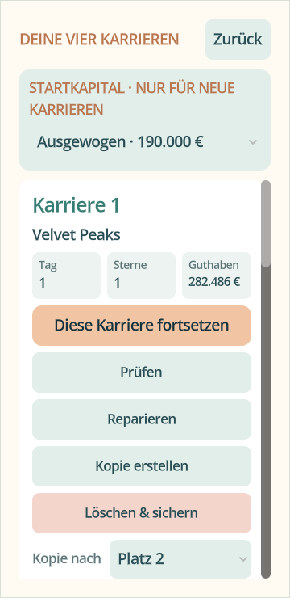
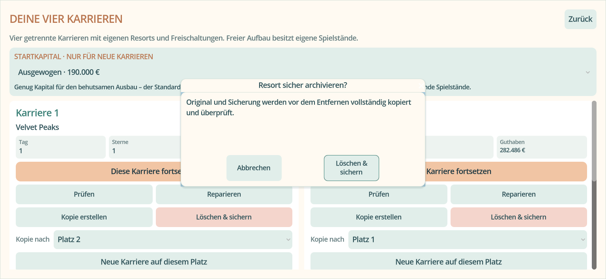

# 0.38.2 – Spielstandreparatur und lesbare Bedienung

Stand: 7. November 2026. Öffentliche Ausgangsbasis: `82bf70026d51cffb2b83cc341521ebb97c89de56` (0.38.1). Lokale Abnahme mit dem offiziellen SHA512-geprüften **Godot 4.5.2**, Software-OpenGL für reale gerenderte Ansichten.

## Behobene Ursachen

1. Das bisherige `HFlowContainer` verteilte keine sinnvollen Mindestbreiten. Mehrere beschriftete Aktionen wurden zu schmalen Balken. Das neue Raster besitzt feste Mindestgrößen, reagiert auf seine tatsächliche Breite und bricht Text um. Das Kopierziel ist eine eigene beschriftete Zeile.
2. Native Dialogfenster benutzen einen eigenen Theme-Kontext. Normalfarbe allein reichte für den fokussierten Bestätigungsknopf nicht aus. Alle relevanten Schriftzustände werden gesetzt. Godot setzt die Mindestgröße seiner Dialogknöpfe intern aus Theme-Konstanten neu; deshalb werden diese ausdrücklich für `AcceptDialog` **und** `ConfirmationDialog` definiert.
3. Die Diagnose erlaubte Wiederherstellung historischer Geometrie bzw. beschädigten Gastzustands. Der manuelle Reparaturpfad akzeptierte dagegen nur eine bereits vollständig ladbare andere Datei. Beide verwenden jetzt dieselbe geprüfte Wiederherstellung. Das reparierte Ergebnis wird vor dem Dateitausch normal geladen und das Original bytegenau archiviert.
4. Eine wiederhergestellte alte Baugeometrie benötigte zuvor bei jedem Start erneut den Ausweichpfad. Ein optionales validiertes boolesches Merkmal erhält diese Kompatibilität im normalisierten Save. Die normale Bauvalidierung beim Erstellen neuer Anlagen bleibt aktiv.

## Lokale Ergebnisse

| Prüfung | Nachgewiesener Umfang |
| --- | --- |
| Originalrelease-Matrix | 45 unveränderte veröffentlichte Originalstände von 0.1.1 bis 0.38.1, per Commit festgelegt; jeweils echte Save-Erzeugung und sieben aktuelle Wiederherstellungsprüfungen (315). Keine erfundenen Zwischenversionen. Alle 45 besitzen tatsächlich einen öffentlichen APK-Release. |
| `save_repair_0382.gd` | 14 Prüfungen: rettbare Hauptdatei ohne Backup, unverändertes Originalarchiv, erneutes normales Laden, Budget/Anlagen/Karriere erhalten, idempotente Reparatur, historische Klassifikation samt Gast-/Geometrieerhalt, Ablehnung ungültiger dauerhafter Daten und falscher Prüfsummen. |
| `save_management_038.gd` | 15 Prüfungen: unveränderte Kopie, belegtes Ziel geschützt, intakte Sicherung bevorzugt, Modusgrenzen, überprüftes Archiv, fremde Plätze erhalten. |
| `readable_controls_0382.gd` | 105 bestandene Prüfungen. Reale Reparatur über den tatsächlichen Knopf; DE/EN, 1536×709, 360×740, 420×860, 740×360. Textmaße, tatsächliche Knopfgrenzen, fokussierte Bestätigungen, Hilfe/Impressum/Community, freie Plätze, Kredit/Abriss; sämtliche instanziierten HUD-Knopfstaaten mit mindestens 4,5:1 Textkontrast. |
| Bestehende Karriere-/UI-Reihen | 25 reale Karriere-Szenenprüfungen, 29 isolierte Karriere-/Save-Prüfungen, 21 freie Save-/Rettungsprüfungen und 56 Hotel-/Personal-/WC-/responsive Karriereprüfungen bestanden. |
| Lokalisierung | 3.088 Meldungen, Platzhalter und Quelltextabdeckung geprüft. |

Der historische Test erzeugt pro Release einen aktiven Starter-Spielstand in Sonnenhang mit dem damaligen Spielmodell und Save-Schreiber. Er vergleicht Geld, Kalender, aktive Gäste, alle Anlagen, Original-SHA256 und aktuellen Save-Roundtrip. Die bereits bestehende Stationszugangs-Migration vor Datenschema 6 ist ausdrücklich berücksichtigt. Für 0.19 und 0.27 bleiben zusätzlich die bestehenden Prüfungen aller acht Fantasieberge in CI erhalten.

Reproduzierbar: `python3 tools/check_historical_saves.py --godot /path/to/Godot_v4.5.2-stable_linux.x86_64`. Fixture-Dateien, Erzeugungs-/Restore-Logs und Ergebnisliste mit Original-Hashes werden unter `build/historical-saves/` erzeugt. In CI läuft die Matrix in drei Gruppen. Eine fehlgeschlagene Gruppe verhindert die Veröffentlichung.

## Ansichten

## Noch erforderliche Abnahme

- Vollständige GitHub-Validierung und Android API 30/36 für den endgültigen Releasecommit. Lokales Software-OpenGL ersetzt keine physische Android-Prüfung. Die bekannten Ressourcenwarnungen beim Beenden der Tests sind kein Nachweis eines im Betrieb behobenen Speicherlecks.
- Die drei gemeldeten privaten Problemdateien samt vorhandenen Sicherungen liegen nicht vor. Ihre konkrete Ursache und individuelle Reparatur bleiben offen. Die Originalrelease-Matrix ist keine Garantie für beliebige fehlende, abgeschnittene oder fremdveränderte Daten.
- Große offene Funktionsumfänge bleiben im [Anforderungsabgleich](029-036-requirements-audit.md) erhalten. Diese Änderung überarbeitet die Speicher-/Dialogbedienung, vervollständigt aber nicht alle Spezialsimulatoren, Landschaftsassets oder Musikprogramme.
