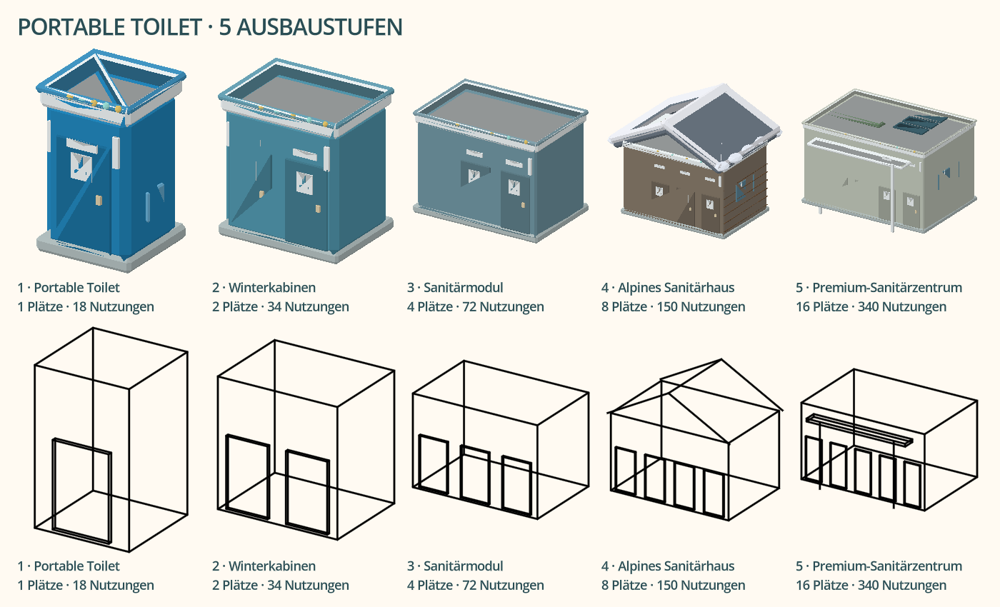
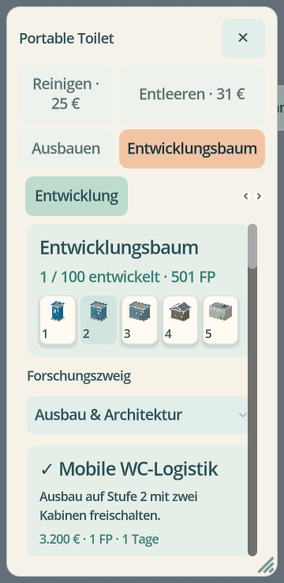

# 0.39 – Portable Toilet und vollständiger Entwicklungsbaum

Stand: 7. November 2026. Basis: 0.38.2-Kandidat `b05069f86900c17ae85384a763b100f3e73d7e4e`; neue Arbeit auf `feat/039-portable-toilet-development`. Lokale Prüfungen mit offiziellem Godot 4.5.2 und tatsächlich gerenderten OpenGL-Ansichten.

| Prüfung | Ergebnis / Reichweite |
| --- | --- |
| `portable_toilet_039.gd` | 436 bestanden: genau ein Kaufobjekt, vier alte Kauf-APIs gesperrt; alle 100 Projekte durch echte Tageswechsel abgeschlossen; Voraussetzungen, Geld/Punkte, aktive Forschung und Speicherung; laufende Wirkungen aller Effektklassen; echte Ausbauangebote; gleiche Gebäude-ID; Kapazität, Fläche und Weltmesh wachsen; blockierter Ausbau bleibt ohne Abbuchung; alte Einzeltypen bleiben ladbar. Die Durchspielprüfung hat kontrolliert bereitgestelltes Kapital/FP und ist kein repräsentativer Wirtschaftlichkeitsnachweis. |
| `portable_toilet_scene_039.gd` | 77 bestanden in DE/EN, 1536×864, 360×740, 420×860, 740×360: sichtbarer Katalog mit genau einer Toilette; zehn tatsächliche Forschungszweige; alle 100 Projektaktionen erreichbar; echter Startknopf und echter Ausbau; lesbare Breiten; Forschungswahl auf Telefonen oberhalb der Faltkante; Verwaltung ohne überdeckende Erfolge. |
| `portable_toilet_assets_scene_039.gd` | 50 bestanden: alle fünf tatsächlichen Weltmeshes wachsen in allen zehn Themes. Geometrieübersicht aus den wirklichen Meshes, keine Bildentwürfe. |
| Bestehendes öffentliches WC | 24 Modell- und 62 echte Flow-/Familien-/Warteschlangen-/Betriebs-/Save-Prüfungen bestanden. Stufenabhängige Werte auf die neue 1/2/4/8/16-Entwicklung angepasst. |
| Hotel-/Personal-/Karriereoberfläche | 56 bestehende Prüfungen bestanden; Hotels erhalten keine öffentlichen WC-Daten. |
| Karriereprogression | 48 Prüfungen bestanden, einschließlich zweier kompletter Winter mit natürlichem Einkommen, Aufträgen und deterministischem Zwischenladen. Alle ursprünglichen Forschungsmeilensteine sind in diesem Zeitraum erreichbar; die 100er-WC-Erweiterung wird nicht als vollständig in zwei Wintern ausbalanciert ausgegeben. |
| Historische Spielstände | Dieselben 45 mit Originalcode erzeugten und per SHA256 belegten Dateien aus der 0.38.2-Matrix erneut mit diesem Code geprüft: 315 Restore-Prüfungen bestanden. Zusätzlich explizite neue Tests alter größerer WC-Typen. |
| Speichermanager / Reparatur | 15 Verwaltungs- und 14 Reparaturprüfungen weiterhin bestanden. |
| Lokalisierung | 3.234 Meldungen mit Platzhaltern und Quelltextabdeckung geprüft. |

## Ansicht der tatsächlichen Assets

## Bedienung auf dem Telefon

Die fünf alten Typ-IDs bleiben als reine Kompatibilitätsdaten erhalten. Der unsichtbare Auswahlindex behält deaktivierte historische Einträge, damit gespeicherte Bearbeitungszuordnungen und bestehende Katalogindizes nicht versetzt werden. Die zwei sichtbaren Baukataloge und die direkte Bau-API bieten ausschließlich das Startmodell an.

## Ausstehende Freigabe und Grenzen

Vollständige CI, Android API 30/36 und abschließende Veröffentlichung sind noch erforderlich. Keine lokale Prüfung auf einem physischen Android-Gerät. Die bekannten Godot-Ressourcenwarnungen beim Beenden gerenderter Tests werden nicht als behobenes Betriebsproblem ausgegeben. Die privaten drei Problemdateien wurden nicht bereitgestellt.

Der Entwicklungsbaum ersetzt keine breite Mehrwinter-Balanceabnahme aller Karten und Startprofile. Sichtbare gelbe Schneespuren, neue Servicefahrzeug-Handlungen und tiefe Hotelarchitektur bleiben eigene offene Aufgaben. Quellen-/Statusabgleich: [0.29–0.36 und Folgestände](029-036-requirements-audit.md).
