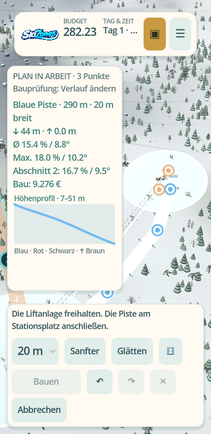
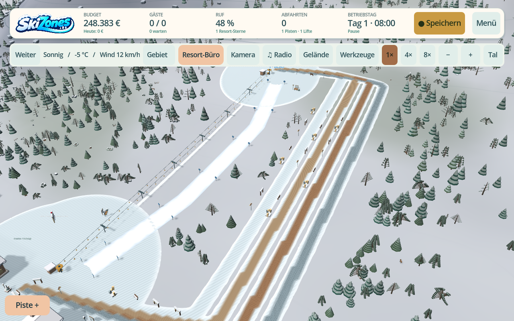
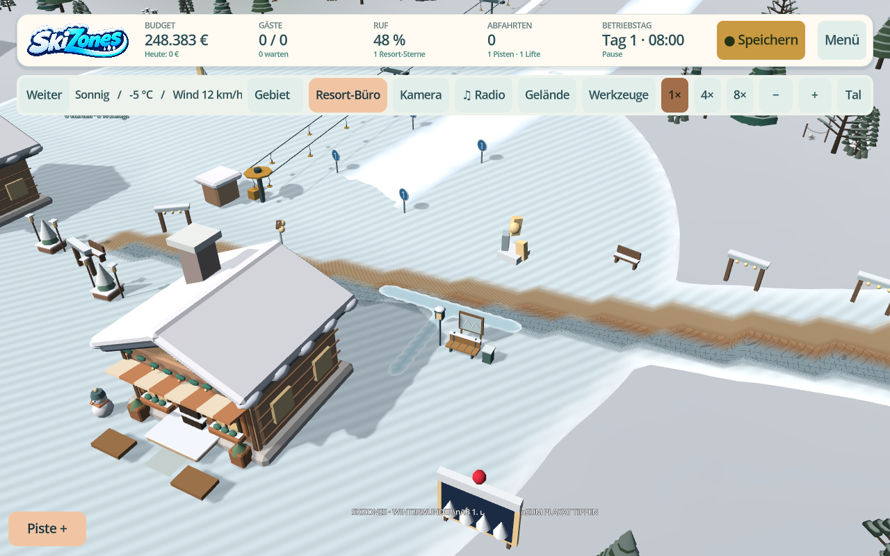

# Pistenplanung, Wege und Schneepfade nach 0.36

Stand: 6. November 2026. Basis `ebb193d` / veröffentlichte 0.36.0. **0.37.0**, Android **versionCode 47** in beiden Profilen, ist seit 6. November 2026 veröffentlicht. Die untenstehenden 14 Reihen dokumentieren den historischen lokalen Vorlauf.

## Ergebnis der lokalen Prüfung

**14 Testreihen, 384 erfolgreiche Prüfungen, 0 fehlgeschlagene Prüfungen.** Godot **4.5.2**, gegen den offiziellen SHA-512-Katalog verifiziert; für die tatsächlichen Oberflächenbilder Xorg-Dummy und Mesa llvmpipe. Testdaten liegen in getrennten `skizones-test`-Verzeichnissen. Die abschließende GUI-/Sitzungsrunde verwendet die finale Spiellogik; die anschließende Versionsanhebung betrifft ausschließlich Projekt-/Exportmetadaten.

| Test | Erfolgreiche Prüfungen |
| --- | ---: |
| `tests/piste_planning.gd` | 20 |
| `tests/paths_and_momentum.gd` | 41 |
| `tests/footwear_pacing_camera_034.gd` | 20 |
| `tests/footwear_persistence_035.gd` | 12 |
| `tests/ground_surface_sampling_032.gd` | 19 |
| `tests/living_alpine_034.gd` | 12 |
| `tests/legacy_routes_free_mode_0342.gd` | 36 |
| `tests/save_rescue_free_slots_0332.gd` | 21 |
| `tests/hotel_room_operations_036.gd` | 28 |
| `tests/walkway_design_037.gd` | 33 |
| `tests/snow_paths_geometry_037.gd` | 9 |
| `tests/expansion_ui_035.gd` | 28 |
| `tests/build_input_scene.gd` | 37 |
| `tests/planning_paths_scene_037.gd` | 68 |

Die neuen Tests sind Teil des vollständigen Build-/Android-Workflows. Der [maschinenlesbare Bericht](planning-paths-after-036-results.json) enthält dieselben Ergebnisse.

## Was konkret geprüft wurde

- Echte gerenderte Oberflächen in Deutsch und Englisch bei **360×740**, **420×860** und **740×360**. Pistenwerte/Höhenprofil ohne Scrollcontainer, keine überlappenden Bauflächen, erreichbare Bau-, Abbruch-, Breiten-, Glätten-, Vorschlags-, Richtungswechsel- und Undo/Redo-Aktionen.
- Lesbare Wege-/Platzkarten auch im schmalen Hochformat; nicht nur die umgebende Buttonfläche, sondern die tatsächlichen Beschriftungen müssen hineinpassen.
- Reale Fingerereignisse erzeugen einen gekrümmten Weg ohne Kamerapan. Ein zweiter Finger verwirft den unbestätigten Strich. Ein gezeichneter Anschluss zwischen Tal und Station besteht die echten Bauprüfungen.
- Alle vier Beläge werden über den echten Controller gebaut. Das tatsächlich erneuerte Weltmesh enthält die jeweilige Oberfläche; nicht nur ein Katalogeintrag oder Vorschaubild. Speichern/Laden erhält die Beläge, alte Wege ohne das optionale Feld bleiben gültig, unbekannte Werte werden atomar zurückgewiesen.
- Schneeabnutzung bleibt mit den bisherigen fünf Werten je Zelle kompatibel. Verbundene Pfade und Sohlenformen werden tatsächlich gerendert und liegen über den sichtbaren Stations-/Platzflächen. Die schrittweise Geometrie ist identisch zur synchron berechneten; ein Resortwechsel verwirft unfertige alte Geometrie.
- Der verifizierte Android-UI-Checkpoint erhält unbestätigte Wegpunkte, Belag und Zeichenmodus. Alte Checkpoints ohne diese optionalen Felder bleiben lesbar. Das ist ein lokaler Prozess-/Datenpfadtest, kein Emulatornachweis.
- Bestehende Weg-/Gegenanstiegslogik, Pistenplanung, Schnee-Persistenz, freie Slots, Legacy-Rettung, Landschaftsmodelle und Hotelzimmerfunktionen bleiben im geprüften Umfang erhalten.

## Sichtbelege aus dem tatsächlich gerenderten Spiel

## Nachgewiesene Android-Veröffentlichung

Die [vollständige Hauptzweig-Pipeline](https://github.com/chekento/SkiZones/actions/runs/42253046515) für `1d731922c5cdb6313b874369e75f5ac51499df78` ist erfolgreich abgeschlossen. API 30 bestand 24 echte Activity-/Surface-Fälle, API 36 bestand 25, einschließlich Signaturwechsel-Abweisung und Updatekontinuität. Die erweiterte Pistenreihe bestand dort 90 Prüfungen; die historischen 68 oben werden nicht als neuer lokaler Lauf umgeschrieben.

[Veröffentlichte APK und Begleitdateien](https://github.com/chekento/SkiZones/releases/tag/v0.37.0): 175.360.875 Bytes, SHA256 `3623fabe2ab7112e55b0d124e609939b39bdd4da75675db884ef931675c3b695`. Der öffentliche Download wurde vollständig gelesen, gegen Manifest und SHA256-Datei verglichen und als ZIP geprüft. Paket `cloud.kosch.skizones`, ARM64, Code 47; Signaturkontinuität zur 0.36 ist im Manifest bestätigt.

## Grenzen dieser Freigabe

- Die Android-Emulatorfreigabe ist oben belegt. Ein Test auf einem physischen Android-Gerät ist weiterhin nicht belegt.
- Der lokale GUI-Prozess meldet beim Beenden verbliebene Canvas-/Text-/Texture-Ressourcen. Die Tests enden mit vollständiger Erfolgssumme und ohne Script-/Shaderfehler; diese Meldungen sind dennoch kein Beleg für einen fehlerfreien Android-Lifecycle.
- Der zusätzliche Lastversuch mit bis zu 1.800 sichtbaren verdichteten Zellen motiviert den in Arbeitsschritte aufgeteilten Meshaufbau. Ein 2,5-ms-Arbeitsbudget ist ein Planungsziel, keine harte Echtzeit- oder Android-FPS-Garantie; einzelne Geometrie-/Commitoperationen können darüber liegen.
- Der Schneeweg ist visuell, keine neue Navigationsabkürzung. Alle vier gebauten Beläge teilen denselben acht Meter breiten begehbaren Korridor. Neue Wirtschaftswerte sind Baukosten, keine behauptete komplette Material-/Wartungssimulation.
- Alte Original-0.19-/0.27-Karrieren und früheste Originaldateien werden weiterhin durch die vorhandenen CI-Fixtures geprüft. Der lokale Bericht übernimmt deren frühere Freigabe nicht als neu ausgeführten vollständigen Originalarchiv-Test.
- Die großen offenen Hotel-/Sanitär-/Szenario-/Assetaufträge stehen im [0.29–0.36-Abgleich](029-036-requirements-audit.md).
